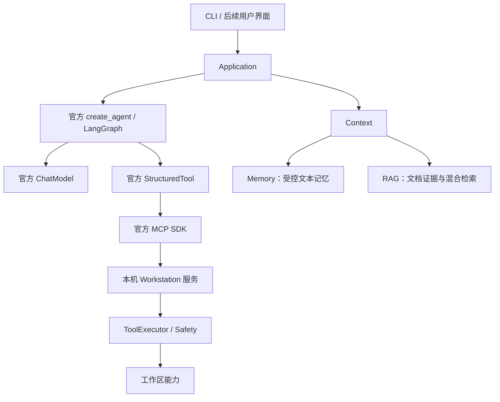

# 架构设计：LangChain 与 LangGraph

> Accepted v0.4，2026-10-06。当前交付范围见 [功能状态](modules.md)。

## 核心原则

- Agent 标准循环使用官方 `create_agent`，底层执行和消息状态由 LangGraph 管理。
- 自定义代码负责工作站业务规则，不重复实现框架循环、工具消息协议或供应商回复解析。
- domain 保留稳定业务结果对象，不依赖模型 SDK、存储或 UI。
- 模型集成只在 models/providers 中组装，通过官方 ChatModel 接入图。
- Context 是 Memory/RAG 进入消息的唯一组装入口，两类数据仍分别管理。
- 工作区操作经过工具 Application、ToolExecutor 和 Safety；不能把框架工具路由当作权限校验。
- 接口层只调用 Application 用例，框架专属内部状态不作为领域对象持久化。
- 本次破坏性重构不保留旧 Agent 循环或兼容导出。

## 当前与目标

默认任务独立执行，可显式启用持久化会话，默认工具在独立本机服务中。可选择同进程工具传输用于教学调试。
Application 将图完成消息转换为业务 Run，只记录步骤类别和结果状态，不默认保存原始工具内容。
默认入口无数据库写入，现有 RunRepository 仅提供显式业务存储，不能恢复框架执行。

`serve-agent` 提供独立本机 HTTP 入口，通过应用用例管理任务提交、状态查询、取消和审批恢复。
该入口显式启用会话检查点；进程内运行列表与持久化会话各自管理，范围见 [Agent HTTP 服务](agent-service.md)。

可选持久化会话已采用官方 SQLite Checkpointer；审批恢复采用框架中断机制；界面消费官方流式更新。
它们要分别建立真实入口、正常及失败验收后，才能在功能清单中标记可用。

长期 Memory 用于用户和任务经验，正文为自然语言 TEXT；RAG 管理外部文档。
Memory 的受控读写、会话、提取和保留边界见 [记忆文档](memory.md)。
RAG 内部直接使用框架 Document 和 Runnable，不保留旧文本块、查询包装或仓库兼容入口。
RAG 摄取、查询及模型请求通过工具执行边界，使用说明见 [RAG 文档](rag.md)。后续持久化变更通过版本化 migration 引入。
模型上下文仍需明确标记检索内容为数据，防止其被误当作系统指令。

## 框架选择与教学

依赖 LangChain、LangGraph 和官方 OpenAI 集成，而非自行维护完整 Agent 框架。
优先从最小官方 Agent、工具协议、图进度和限制中间件学习，再加入会话、审批、UI、记忆和 RAG。
具体运行和验收见 [框架教学](framework-tutorial.md)。
