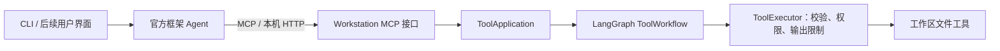

# 本机 Workstation MCP 服务

本阶段交付：独立运行的本机能力服务，外部 Agent 可以发现和调用现有只读工具。
默认 MCP 地址 `http://127.0.0.1:8765/mcp`，健康检查地址 `http://127.0.0.1:8765/health`。

## 服务关系与完整调用链



`serve` 运行在本仓库中，只承担工作站能力服务。Agent 的模型调用、规划和对话可以留在另一个进程或项目。
MCP 接口不会复制 Agent 逻辑，也不会直接读取文件；发现调用 Application，执行通过现有图和执行器。
新增工具注册到现有工具集合后，CLI 与 MCP 使用相同参数 schema、权限策略和结果契约。

## 本机部署：Windows PowerShell 7

在仓库根目录运行：

```powershell
uv sync
$service = & .\scripts\start-local-service.ps1
uv run python examples/local_agent_client.py read_text_file --path .python-version
```

启动脚本会检查配置和端口，后台启动隐藏窗口的 Python 服务，等待健康检查通过，然后返回
`System.Diagnostics.Process`。默认工作区是仓库根目录，默认端口 8765。
服务就绪后，独立客户端会先打印 `list_files`、`read_text_file` 的发现结果，再打印：

```json
{"tool_name":"read_text_file","content":"3.13\n","success":true,"error":null,"error_code":null}
```

工作区可在启动前调整；客户端的 `--path` 相对该目录。例如：

```powershell
$env:WORKSTATION_AGENT_WORKSPACE = 'D:\my-workspace'
$env:WORKSTATION_AGENT_SERVICE_PORT = '8766'
$service = & .\scripts\start-local-service.ps1
uv run python examples/local_agent_client.py list_files
```

停止本终端启动的服务：

```powershell
$service.Kill()
$service.WaitForExit()
```

脚本为尚未配置的访问令牌生成随机值，保存在当前 PowerShell 进程的环境变量中，不打印、不写入文件。
**从同一终端启动外部 Agent，才能继承该令牌。** 服务和 Agent 若由不同终端或其他程序启动，
应由调用方提前向两边注入相同的 `WORKSTATION_AGENT_SERVICE_TOKEN`。
终端关闭后无法从本项目找回自动生成的令牌；需要管理长驻进程时，应由自己的服务管理器配置令牌。

## 前台启动与诊断

不用后台脚本时，设置配置后直接启动：

```powershell
$env:WORKSTATION_AGENT_SERVICE_TOKEN = [guid]::NewGuid().ToString('N')
uv run workstation-agent doctor --service
uv run workstation-agent serve
```

该命令持续运行；Ctrl+C 停止。`doctor --service` 检查启动所需配置，不检查已运行进程或端口。
缺少令牌或工作区不存在时 `serve` 退出码为 2；启动失败、端口占用时退出码为 1。
普通 `doctor` 不强制要求服务令牌，保持现有 CLI 可用。

| 环境变量 | 默认 | 校验/用途 |
| --- | --- | --- |
| `WORKSTATION_AGENT_WORKSPACE` | 当前目录；脚本默认为仓库根目录 | 必须是已存在目录；工具路径不得越界 |
| `WORKSTATION_AGENT_SERVICE_PORT` | `8765` | 整数 1–65535 |
| `WORKSTATION_AGENT_SERVICE_TOKEN` | 空；脚本可自动生成 | 启动服务必须配置；32–256 个字母、数字、`_`、`-` |
| `WORKSTATION_AGENT_TOOL_OUTPUT_CHARS` | `50000` | 正整数；限制工具结果中的文本长度 |

项目不会自动读取 `.env`。令牌应通过 `Authorization: Bearer …` 请求头传递，不放入 URL。
`/health` 不需要令牌，仅返回服务名称、版本和就绪状态，不返回工作区路径或配置。

## Agent 如何接入

独立可运行示例：[local_agent_client.py](../examples/local_agent_client.py)。
关键连接方式使用官方 SDK：

```python
async with httpx2.AsyncClient(
    headers={"Authorization": f"Bearer {token}"}, trust_env=False, timeout=15,
) as http:
    async with Client(streamable_http_client(url, http_client=http)) as client:
        tools = await client.list_tools()
        result = await client.call_tool("read_text_file", {"path": "README.md"})
```

`Client` 来自 `mcp`，`streamable_http_client` 来自 `mcp.client.streamable_http`。
只接入 MCP 的另一个项目可安装 `mcp>=2.3,<3` 和 `httpx2>=2,<3`，无需导入本项目核心层。
本仓库示例复用 `Settings` 取得本机地址和令牌；上面的连接方式也可使用外部 Agent 自己的配置。

结果的 `structured_content` 是完整 `ToolResult`。`content[0].text` 是同一结果的 JSON 文本，
供只处理文本的客户端使用。不要把它当成未经包装的文件内容。
业务失败返回 `is_error=true` 和 `error_code`，例如 `invalid_arguments`、`unknown_tool`、
`path_outside_workspace`、`not_found`、`invalid_utf8`、`permission_required`。
认证和无效 HTTP 请求在传输层拒绝，不能当成已经执行工具的结果。
外部 Agent 可以把这些结果交给模型决定下一步；直接客户端示例不包含模型规划；自然语言任务使用 `workstation-agent run`。

## 边界与运行成本

- 只监听 IPv4 回环 `127.0.0.1`，没有开放局域网入口的配置。
- MCP 所有方法都要求令牌；Host、Origin 限制为当前端口的本机地址，无浏览器跨域配置。
- 这是本机共享令牌认证，没有实现面向远程部署的 OAuth 流程。
- 内置工具只有目录列表和 UTF-8 文本读取。默认权限仍只允许 `SAFE_READ`，高权限工具返回审批错误，
  还不能在界面批准后恢复。
- 请求体上限 64 KiB；文件读取在工作线程执行，不阻塞 HTTP 事件循环。
- 服务使用无状态 Streamable HTTP，不持久化 MCP 会话、调用结果或 LangGraph 检查点。
- 没有工具超时和取消恢复；客户端断开不能保证立即停止已开始的工作线程。
- 启动脚本不是 Windows 系统服务安装器；没有登录自启、自动重启或界面。
- MCP 服务默认支持文件读取和 RAG 查询；配置并授权 RAG 模型后，可在工具权限边界内调用 embedding 与重排。
  Agent 循环仍在 run 入口。RAG 摄取通过 CLI 受控写入，持久化 Memory 尚待交付，见 [RAG 文档](rag.md)。

依赖用途：官方 `mcp` SDK 处理协议与协商；Starlette 承载 HTTP 接口和中间件；Uvicorn 运行服务；
`httpx2` 用于 SDK 客户端连接。相比自行编写协议，需要安装这些包并常驻一个 Python 服务进程，
但无需额外平台账户、数据库服务或模型费用。本阶段没有再引入一层 Web 框架。
依赖版本由 `uv.lock` 固定。协议与 SDK 用法参考[官方 Python SDK 文档](https://py.sdk.modelcontextprotocol.io/)。

## 验收

```powershell
uv run python -m unittest discover -s tests -v
uv run workstation-agent doctor
uv build
```

`tests/integration/test_local_service.py` 启动真实独立服务进程，通过官方 SDK 客户端执行发现、
读取、目录列举、并发隔离、现代/旧初始化连接、参数错误、越界、文件不存在、非法 UTF-8 和输出限制；
另起客户端进程运行示例。还检查无令牌/错误令牌、Host/Origin、请求体格式和大小、端口占用、
诊断与启动脚本；测试清理自己的服务进程，并检查服务日志不包含测试令牌和文件内容。
`tests/integration/test_mcp_adapter.py` 验证 schema 一致、高权限工具无法绕过执行器以及异常脱敏。
配置边界放在单元测试中。Windows 启动脚本测试在无 PowerShell 7 的平台跳过。
